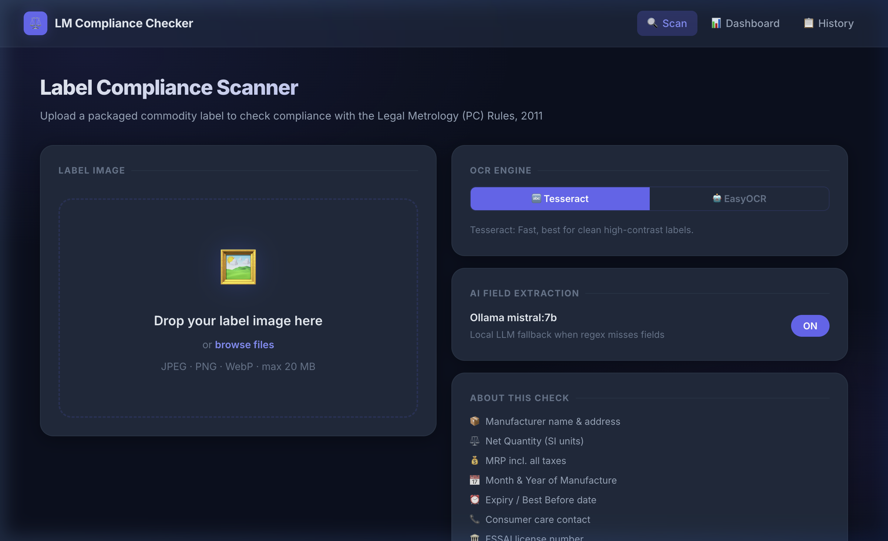
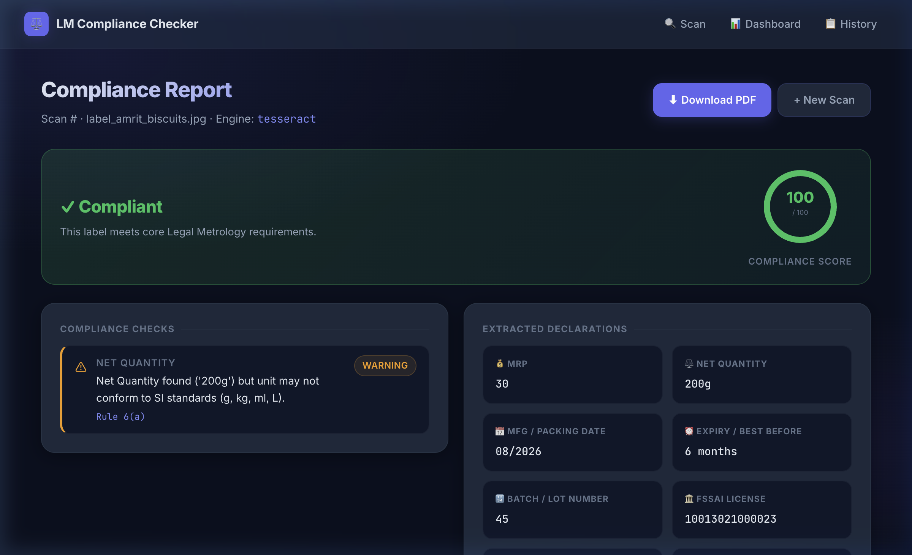
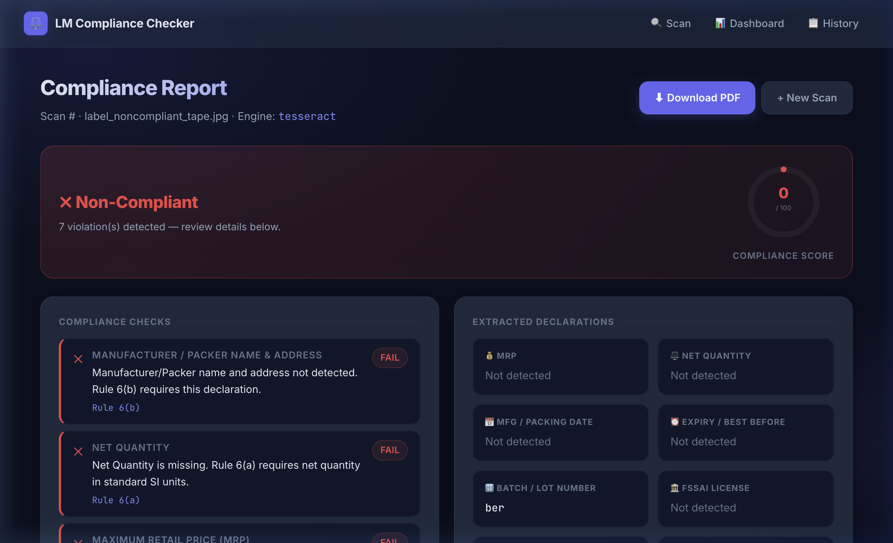
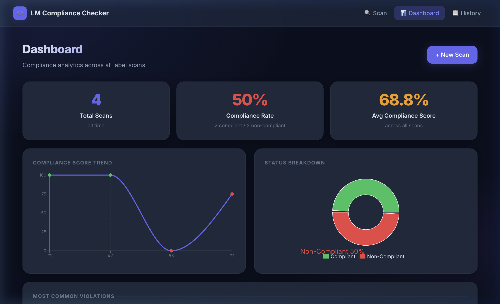
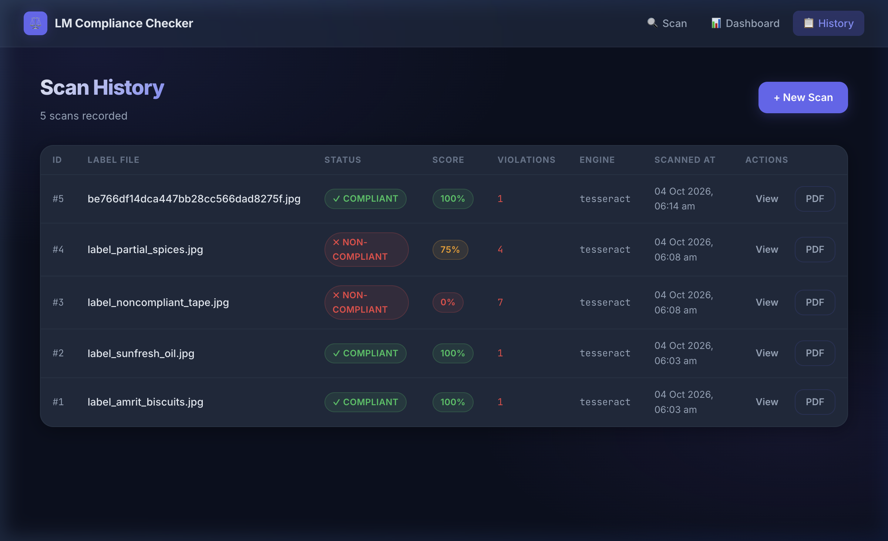
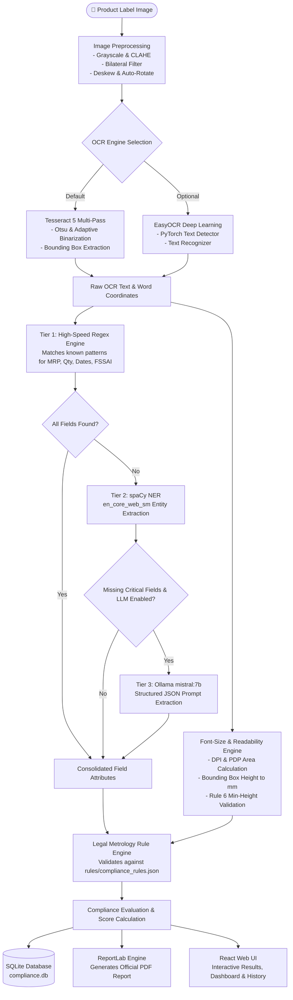

# 📦 Package Saathi (पैकेज साथी)
### *AI-Powered Legal Metrology & Packaged Commodity Compliance Assistant*

[](https://python.org)
[](https://fastapi.tiangolo.com)
[](https://react.dev)
[](https://vitejs.dev)
[](https://github.com/tesseract-ocr/tesseract)
[](https://spacy.io)
[](https://ollama.com)
[](LICENSE)

**Package Saathi** is an automated, end-to-end regulatory compliance auditing system designed for the **Legal Metrology (Packaged Commodities) Rules, 2011** and **FSSAI** guidelines in India. 

Simply snap or upload a photo of any packaged commodity label—packaged food, cosmetics, electronics, or everyday items—and **Package Saathi** instantly extracts all regulatory declarations, verifies mandatory legal requirements, checks minimum font size compliance, computes a weighted compliance score, highlights specific violations with legal citations, and outputs an official, audit-ready PDF compliance certificate.

---

## 📑 Table of Contents

- [Key Highlights](#-key-highlights)
- [Visual Walkthrough & UI Showcase](#-visual-walkthrough--ui-showcase)
- [How It Works (Under the Hood)](#-how-it-works-under-the-hood)
  - [End-to-End Pipeline Flowchart](#end-to-end-pipeline-flowchart)
  - [The 6 Core Pipeline Stages](#the-6-core-pipeline-stages)
- [Mandatory Declarations Checked](#-mandatory-declarations-checked)
- [Getting Started: Clone to Run](#-getting-started-clone-to-run)
  - [1. Prerequisites](#1-prerequisites)
  - [2. Clone the Repository](#2-clone-the-repository)
  - [3. Option A — Automated One-Click Start (Recommended)](#3-option-a--automated-one-click-start-recommended)
  - [4. Option B — Manual Step-by-Step Setup](#4-option-b--manual-step-by-step-setup)
  - [5. Option C — Run with Docker & Docker Compose](#5-option-c--run-with-docker--docker-compose)
- [Testing with Sample Labels](#-testing-with-sample-labels)
- [System Architecture](#-system-architecture)
- [Project Directory Structure](#-project-directory-structure)
- [REST API Reference](#-rest-api-reference)
- [Customizing & Updating Rules](#-customizing--updating-rules)
- [Troubleshooting & FAQs](#-troubleshooting--faqs)
- [Legal Disclaimer](#-legal-disclaimer)

---

## ✨ Key Highlights

- **Dual-Engine OCR Engine**: Combines OpenCV preprocessing (CLAHE, bilateral filtering, adaptive deskewing) with **Tesseract 5** multi-pass thresholding and **EasyOCR** deep learning fallback for high recall on crinkled, reflective, or curved packaging.
- **Three-Tier Intelligent NLP Pipeline**:
  1. *Deterministic Regex & Pattern Matching* (Zero-latency extraction for standard formats)
  2. *spaCy Named Entity Recognition (NER)* (Contextual entity isolation for addresses, weights, dates)
  3. *Local LLM Reasoning via Ollama Mistral:7b* (Handles obscure phrasing, noisy OCR, multilingual text, and unstructured label text)
- **Rule 6 Font-Size & Readability Engine**: Converts pixel bounding boxes to real-world millimeters using EXIF or calibrated DPI, verifying minimum numeral height compliance against the Principal Display Panel (PDP) area.
- **Config-Driven Rule Engine**: Rules are defined in decoupled, version-controlled JSON (`rules/compliance_rules.json`). Updates issued by the Legal Metrology Division require zero code changes.
- **Instant Scored Pass/Fail Audit**: Categorizes checks into Compliant, Violations (Errors), and Warnings, complete with Legal Rule clause citations (e.g., Rule 6(a), Rule 6(c)).
- **Audit-Ready PDF Generation**: One-click download of print-ready compliance inspection certificates generated dynamically with ReportLab.
- **Analytics Dashboard & Persistent History**: SQLite + SQLAlchemy ORM backend records all inspection data, visualizing real-time compliance trends, score distributions, and top offending violations via Recharts.

---

## 📸 Visual Walkthrough & UI Showcase

### 1. Label Upload & Engine Configuration
Upload any high-res or smartphone image of a packaged commodity (PNG, JPG, WebP up to 20 MB). Switch between Tesseract and EasyOCR engines or toggle the Ollama LLM reasoning assistant.



---

### 2. Instant Compliant Audit Result (100% Pass)
Labels that meet all Rule 6 requirements (e.g., MRP with inclusive taxes, Net Qty in SI units, complete manufacturer address, dates, consumer helpline, and FSSAI number) receive a verified badge and a 100% compliance score.



---

### 3. Non-Compliant Violation Detection & Legal Rule Citations
When declarations are absent, improperly formatted, or missing mandatory clauses (e.g., missing tax declaration, missing manufacturer address, or missing consumer helpline), the engine flags each violation with the exact legal clause violated and provides remediation guidance.



---

### 4. Real-Time Compliance Analytics Dashboard
Track aggregate compliance rates, total scanned products, average compliance scores, score distributions, historical compliance timelines, and top recurring violations across all processed batches.



---

### 5. Audit History & Inspection Records
Inspect previous scans, filter by status, review timestamps, access previous reports, and export compliance documents anytime.



---

## 🧠 How It Works (Under the Hood)

### End-to-End Pipeline Flowchart



### The 6 Core Pipeline Stages

1. **Image Preprocessing (`backend/OCR.py`)**:
   Standardizes lighting, boosts contrast using Contrast Limited Adaptive Histogram Equalization (CLAHE), removes noise via Bilateral Filtering while preserving character edges, and automatically detects text skew angle to straighten tilted labels.

2. **OCR Text & Coordinate Extraction (`backend/OCR.py`)**:
   Runs multi-pass binarization (standard Otsu thresholding + adaptive Gaussian thresholding). Extracts raw textual tokens along with word-level bounding box coordinates (`x`, `y`, `width`, `height`).

3. **Three-Tier NLP Field Extraction (`backend/nlp.py`)**:
   - **Tier 1 (Regex)**: Ultra-fast regex patterns capture structured declarations (e.g., `Net Wt: 26g`, `₹ 20.00`, `14-digit FSSAI`).
   - **Tier 2 (spaCy NER)**: Uses `en_core_web_sm` to recognize Organizations (`ORG`), Dates (`DATE`), and Locations (`GPE`) for manufacturer names and packing premises.
   - **Tier 3 (Ollama LLM Fallback)**: For hard-to-parse, fragmented, or ambiguous labels, prompts a local **Mistral 7B** model with zero cloud dependencies to return valid JSON fields.

4. **Font-Size & Readability Verification (`backend/font_size_checker.py`)**:
   Estimates the Principal Display Panel (PDP) surface area, determines the mandatory minimum numeral height (e.g., 1.0 mm to 6.0 mm depending on PDP size as per Rule 6(h)), converts bounding box pixel heights into millimeters using EXIF/calibrated DPI, and checks each block for legibility.

5. **Rule Engine & Scoring (`backend/rule_engine.py`)**:
   Compares extracted data against rules specified in `rules/compliance_rules.json`. Computes a weighted compliance score:
   $$\text{Score} = \frac{\text{Passed Mandatory Checks}}{\text{Total Required Checks}} \times 100$$
   Violations are assigned severity ratings (`error`, `warning`, `info`) with official legal citations.

6. **Persistence & PDF Reporting (`backend/report_generator.py` & `backend/database.py`)**:
   Persists the scan session into SQLite (`data/compliance.db`), stores uploaded images in `data/uploads/`, and compiles a downloadable vector PDF report in `data/reports/`.

---

## ⚖️ Mandatory Declarations Checked

In accordance with **The Legal Metrology (Packaged Commodities) Rules, 2011 (Rule 6)** and relevant amendments:

| Mandatory Field | Legal Metrology Rule | Requirement & Specification | Severity if Missing |
|:---|:---|:---|:---:|
| **Net Quantity** | Rule 6(1)(a) | Declared in standard SI units (g, kg, ml, L, or Number/N). Must not include tare weight. | 🔴 Error |
| **Manufacturer / Packer / Importer** | Rule 6(1)(b) | Complete corporate name and physical postal address (including PIN code). | 🔴 Error |
| **Maximum Retail Price (MRP)** | Rule 6(1)(c) | Clear price in INR (`₹` or `Rs.`) explicitly stating *"inclusive of all taxes"*. | 🔴 Error |
| **Date of Manufacture / Packing** | Rule 6(1)(e) | Month and year of packing or manufacturing (`MM/YYYY` or `Mon YYYY`). | 🔴 Error |
| **Consumer Care Contact** | Rule 6(1)(k) | Dedicated consumer care telephone number, email address, or contact address. | 🔴 Error |
| **Best Before / Expiry Date** | Rule 6(1)(f) | Expiration or best-before timeframe (mandatory for food, pharma, cosmetics). | 🟡 Warning |
| **FSSAI License Number** | FSSAI Regulations | Valid 14-digit license number accompanied by the FSSAI logo for food products. | 🟡 Warning |
| **Batch / Lot Number** | Rule 6(1)(g) | Batch, lot, or code identification mark for traceability. | 🔵 Info |
| **Minimum Numeral Height** | Rule 6 & Schedule | Numerals and letters must conform to the minimum height standards based on PDP area. | 🟡 Warning |

---

## 🚀 Getting Started: Clone to Run

Follow these instructions to get **Package Saathi** running locally on your workstation.

### 1. Prerequisites

Ensure your system has the following tools installed:

- **Git**: [Download Git](https://git-scm.com/)
- **Python**: Version `3.10` or higher ([python.org](https://python.org))
- **Node.js**: Version `18.x` or higher and `npm` ([nodejs.org](https://nodejs.org))
- **Tesseract OCR Engine**:
  - **macOS** (via Homebrew):
    ```bash
    brew install tesseract
    ```
  - **Ubuntu / Debian**:
    ```bash
    sudo apt update && sudo apt install -y tesseract-ocr libtesseract-dev
    ```
  - **Windows**:
    Download the installer from [UB-Mannheim Tesseract](https://github.com/UB-Mannheim/tesseract/wiki) and add Tesseract to your system `PATH`.
- *(Optional)* **Ollama** (for local LLM extraction fallback):
  - Download from [ollama.com](https://ollama.com)
  - Run `ollama pull mistral:7b`

---

### 2. Clone the Repository

Open your terminal and clone the repository:

```bash
git clone https://github.com/your-username/Package-Saathi.git
cd Package-Saathi
```

*(If you are working inside the extracted project directory, simply navigate to `SIH(Working)`)*

---

### 3. Option A — Automated One-Click Start (Recommended)

We provide an automated start script `start.sh` that checks dependencies, installs required Python and Node libraries, downloads the spaCy language model, pulls the Ollama model if available, and launches both backend and frontend concurrently:

```bash
# Make the startup script executable
chmod +x start.sh

# Run the automated launcher
./start.sh
```

Once started, the services will be accessible at:
- **Web App (Frontend)**: [http://localhost:5173](http://localhost:5173)
- **API Documentation (Swagger UI)**: [http://localhost:8000/docs](http://localhost:8000/docs)
- **API ReDoc**: [http://localhost:8000/redoc](http://localhost:8000/redoc)

---

### 4. Option B — Manual Step-by-Step Setup

If you prefer to run services in separate terminal windows:

#### Terminal 1: Backend (FastAPI)

```bash
# 1. Navigate to the backend directory
cd backend

# 2. Create and activate a Python virtual environment
python3 -m venv venv

# On macOS/Linux:
source venv/bin/activate
# On Windows (PowerShell):
# .\venv\Scripts\Activate.ps1

# 3. Upgrade pip and install Python dependencies
pip install --upgrade pip
pip install -r requirements.txt

# 4. Download the spaCy English NLP model
python -m spacy download en_core_web_sm

# 5. Start the FastAPI server
uvicorn main:app --reload --host 0.0.0.0 --port 8000
```

#### Terminal 2: Frontend (React + Vite)

```bash
# 1. Navigate to the frontend directory
cd frontend

# 2. Install Node dependencies
npm install

# 3. Start the Vite development server
npm run dev
```

Open your browser and navigate to **[http://localhost:5173](http://localhost:5173)**.

#### Terminal 3 *(Optional)*: Ollama LLM Service

If you want the AI reasoning fallback enabled:

```bash
# Start Ollama service (if not already running as a daemon)
ollama serve

# Pull the Mistral 7B model
ollama pull mistral:7b
```

---

### 5. Option C — Run with Docker & Docker Compose

Deploy the entire application inside isolated Docker containers without installing Python or Node.js locally:

#### Production Deployment
```bash
docker compose up --build
```
The compiled React frontend is served directly by the FastAPI backend on **[http://localhost:8000](http://localhost:8000)**.

#### Development with Hot-Reloading
```bash
docker compose --profile dev up --build
```
Runs the FastAPI server on port `8000` and Vite dev server on port `5173` with volume mounts for live editing.

---

## 🧪 Testing with Sample Labels

We provide pre-loaded real-world product label images in the [`labels/`](labels/) directory representing both compliant and non-compliant samples:

| Sample Image File | Product Type | Expected Compliance Status | Test Scenarios Checked |
|:---|:---|:---:|:---|
| `labels/Kurkure.jpg` | Namkeen / Snack | ✅ Compliant (100%) | Complete FSSAI, MRP with taxes, net weight, consumer contact, MFD. |
| `labels/Lays.jpg` | Potato Chips | ✅ Compliant (100%) | Full Rule 6 declarations, multi-line address, imperial & metric quantities. |
| `labels/Dairymilk.jpg` | Confectionery | ✅ Compliant (100%) | Per-serve nutrition, expiry period, barcode/batch number. |
| `labels/Masala.jpg` | Ground Spices | ⚠️ Warnings (75%) | Missing FSSAI license check, font height variance. |
| `labels/Bulb.jpg` | Electronics / Hardware | ❌ Non-Compliant | Missing food-specific declarations, testing non-food commodity rules. |
| `labels/Protein.jpg` | Dietary Supplement | ⚠️ / ❌ | Complex label with multi-column layout and ingredient tables. |

**How to test:**
1. Open the app at [http://localhost:5173](http://localhost:5173).
2. Drag and drop any image from `labels/` into the upload zone.
3. Click **"Run Compliance Scan"**.
4. View the extracted fields, compliance verdict, and click **"Download PDF Report"**.

---

## 🏗️ System Architecture

```
┌────────────────────────────────────────────────────────────────────────┐
│                        CLIENT LAYER (React 18 + Vite)                  │
│  - Drag & Drop Upload Zone    - Live Compliance Score Gauge            │
│  - Rule Violation Breakdowns  - Recharts Historical Trends             │
│  - One-click PDF Downloader   - Paginated Audit History                │
└───────────────────────────────────┬────────────────────────────────────┘
                                    │ HTTP / REST (Vite Proxy :5173 -> :8000)
┌───────────────────────────────────▼────────────────────────────────────┐
│                    API GATEWAY (FastAPI / Uvicorn :8000)               │
│  POST /api/scan      GET /api/scan/{id}      GET /api/dashboard        │
│  GET  /api/history   GET /api/report/{id}    GET /api/health           │
└──────┬──────────────────────┬───────────────────────────┬──────────────┘
       │                      │                           │
┌──────▼──────────────┐┌──────▼───────────────────┐┌──────▼──────────────┐
│  VISION & OCR       ││  INTELLIGENT EXTRACTION  ││  EVALUATION & PDF   │
│  - OpenCV CLAHE     ││  - Regex Tokenizer       ││  - Rule Engine      │
│  - Bilateral Filter ││  - spaCy NER Pipeline    ││  - Font Calculator  │
│  - Tesseract 5      ││  - Ollama mistral:7b LLM ││  - ReportLab PDF Gen│
│  - EasyOCR Engine   ││    (Local Fallback)      ││  - SQLite ORM       │
└─────────────────────┘└──────────────────────────┘└─────────────────────┘
```

---

## 📂 Project Directory Structure

```
Package-Saathi/
├── backend/                                # FastAPI Backend Service
│   ├── main.py                             # API route definitions and request lifecycle
│   ├── OCR.py                              # OpenCV preprocessing, Tesseract & EasyOCR integration
│   ├── nlp.py                              # Three-tier field extraction (Regex -> spaCy -> Ollama)
│   ├── font_size_checker.py                # PDP area calculation & Rule 6 numeral height verification
│   ├── rule_engine.py                      # Compliance validation engine against JSON rules
│   ├── report_generator.py                 # PDF compliance certificate generator (ReportLab)
│   ├── database.py                         # SQLAlchemy database models & session management
│   └── requirements.txt                    # Python backend dependencies
├── frontend/                               # React Single Page Application (SPA)
│   ├── index.html                          # HTML shell
│   ├── vite.config.js                      # Vite configuration & backend proxy
│   ├── package.json                        # Node.js dependencies & scripts
│   └── src/
│       ├── App.jsx                         # Main routing & application shell
│       ├── index.css                       # Modern dark glassmorphic design system
│       └── pages/
│           ├── Upload.jsx                  # Scan upload, engine switch, and LLM toggle
│           ├── Results.jsx                 # Compliance score gauge, checks & PDF download
│           ├── Dashboard.jsx               # Analytics charts (Recharts) & metrics
│           └── History.jsx                 # Paginated historical scan logs
├── rules/
│   └── compliance_rules.json               # Decoupled, versioned Legal Metrology rule definitions
├── labels/                                 # Sample packaged commodity label images for testing
│   ├── Kurkure.jpg
│   ├── Lays.jpg
│   ├── Dairymilk.jpg
│   └── Masala.jpg
├── docs/                                   # Documentation & screenshots
│   └── screenshots/                        # UI previews used in README
├── data/                                   # Runtime data storage (created at runtime, gitignored)
│   ├── compliance.db                       # SQLite database
│   ├── uploads/                            # Stored label images
│   └── reports/                            # Generated PDF audit reports
├── Dockerfile                              # Multi-stage production container build
├── docker-compose.yml                      # Production & dev Docker orchestration
├── start.sh                                # Automated development startup script
└── README.md                               # Project documentation
```

---

## 📡 REST API Reference

### 1. Execute Compliance Scan
```http
POST /api/scan
Content-Type: multipart/form-data
```

| Parameter | Type | Required | Default | Description |
|:---|:---|:---:|:---|:---|
| `file` | File | Yes | — | Label image (`.jpg`, `.jpeg`, `.png`, `.webp`, max 20MB) |
| `engine` | string | No | `"tesseract"` | OCR engine: `"tesseract"` or `"easyocr"` |
| `use_llm` | boolean | No | `true` | Enable Ollama local LLM fallback |

#### Example cURL
```bash
curl -X POST "http://localhost:8000/api/scan" \
  -F "file=@labels/Kurkure.jpg" \
  -F "engine=tesseract" \
  -F "use_llm=true"
```

#### Sample Response Body (200 OK)
```json
{
  "scan_id": 1,
  "image_filename": "Kurkure.jpg",
  "engine_used": "tesseract",
  "llm_used": false,
  "extracted_fields": {
    "mrp": "20.00",
    "net_quantity": "82 g",
    "mfg_date": "04/2026",
    "expiry_date": "Best before four months from manufacture",
    "batch_number": "N3 24:02",
    "fssai_license": "10014064000435",
    "consumer_helpline": "1800 22 4020",
    "consumer_email": "feedback@pepsico.com",
    "manufacturer_name": "PepsiCo India Holdings Pvt. Ltd.",
    "inclusive_of_taxes": true
  },
  "compliance_report": {
    "overall_status": "compliant",
    "compliance_score": 100.0,
    "checks": [
      {
        "id": "mrp",
        "label": "Maximum Retail Price (MRP)",
        "status": "pass",
        "severity": "error",
        "found_value": "₹20.00 (Incl. of all taxes)",
        "message": "Valid MRP declaration found with inclusive of taxes clause."
      }
    ],
    "violations": []
  },
  "font_size_report": {
    "pdp_area_cm2": 180.5,
    "min_required_mm": 2.0,
    "failing_blocks": 0,
    "overall_pass": true
  },
  "report_available": true
}
```

### 2. Retrieve Scan by ID
```http
GET /api/scan/{scan_id}
```
Returns the full scan results and violation analysis for any previously processed label.

### 3. Download Compliance PDF Report
```http
GET /api/report/{scan_id}
```
Returns a downloadable, print-ready PDF certificate (`application/pdf`).

### 4. Fetch Scan History
```http
GET /api/history?limit=20&offset=0
```
Returns a paginated list of all scans sorted with the newest inspections first.

### 5. Aggregate Dashboard Metrics
```http
GET /api/dashboard
```
Returns summary statistics: total scanned, compliant count, compliance percentage, score trend over time, and top violations distribution.

---

## ⚙️ Customizing & Updating Rules

The compliance checks are driven entirely by [`rules/compliance_rules.json`](rules/compliance_rules.json). When regulatory amendments occur:

1. Open `rules/compliance_rules.json`.
2. Modify or add the rule item (e.g., adjust `min_font_height_mm`, add `regex_hints`, or change `required_for_categories`).
3. Increment `"schema_version"`.
4. **No backend rebuild or server restart is necessary**—the rule engine dynamically reads the configuration on each scan.

---

## 🛠️ Troubleshooting & FAQs

### 1. `tesseract: command not found` or `TesseractNotFoundError`
- **Cause**: The Tesseract OCR binary is not installed or not in your system `$PATH`.
- **Solution**:
  - macOS: `brew install tesseract`
  - Linux: `sudo apt install -y tesseract-ocr`
  - Windows: Install via [UB-Mannheim installer](https://github.com/UB-Mannheim/tesseract/wiki) and set `pytesseract.pytesseract.tesseract_cmd = r'C:\Program Files\Tesseract-OCR\tesseract.exe'`.

### 2. `Can't find model 'en_core_web_sm'`
- **Cause**: The spaCy NLP model has not been downloaded into the Python environment.
- **Solution**:
  ```bash
  python -m spacy download en_core_web_sm
  ```

### 3. Port 8000 or 5173 is already in use
- **Solution**:
  - Change the backend port: `uvicorn main:app --port 8001` (update `vite.config.js` proxy accordingly).
  - Or terminate the existing process:
    ```bash
    # Find and kill process on port 8000
    lsof -ti:8000 | xargs kill -9
    # Find and kill process on port 5173
    lsof -ti:5173 | xargs kill -9
    ```

### 4. Ollama LLM is slow or times out
- **Explanation**: Ollama runs Mistral 7B locally on CPU or GPU. If you lack a dedicated GPU or have limited RAM, you can disable the LLM toggle on the upload page. The app will smoothly rely on Tier 1 (Regex) and Tier 2 (spaCy), which execute in milliseconds.

---

## ⚖️ Legal Disclaimer

> **Important Notice:**
> **Package Saathi** is an automated auditing decision-support tool created for informational and quality assurance purposes. While it adheres to the statutory provisions of **The Legal Metrology Act, 2009** and **The Legal Metrology (Packaged Commodities) Rules, 2011**, automated OCR and machine learning evaluations are subject to image quality, perspective distortions, and sensory variations.
>
> This tool does not constitute binding legal counsel. Final certification and statutory enforcement remain under the jurisdiction of the **Legal Metrology Division, Department of Consumer Affairs, Government of India**. Consult certified legal metrology officers for statutory audits.

---

<div align="center">
  <sub>Built for the Smart India Hackathon & Legal Metrology Compliance Automation. Made with ❤️ by the Package Saathi Team.</sub>
</div>
